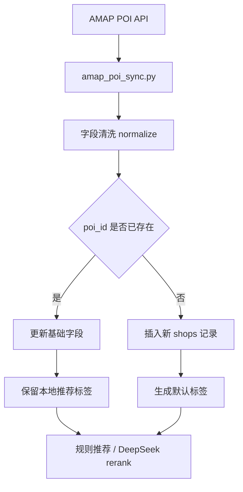

# Chapter 13：接入高德地图 POI 数据源

## 目标

本章目标是把项目的数据来源从“手写 CSV / 手工录入”升级为“高德地图 POI API + 本地 SQLite 缓存 + 人工标签增强”。

完成后，你的项目不再只是 mock 数据推荐，而是可以从真实地图 POI 中同步清水河校区附近的餐饮店铺，再进入现有推荐系统。

本章最终效果：

- 后端支持配置 `AMAP_WEB_SERVICE_KEY`。
- 可以通过脚本从高德地图拉取清水河附近餐饮 POI。
- 将高德 POI 字段清洗并映射到本项目 `shops` 表。
- 使用 `poi_id` 做去重，重复店铺更新，不重复插入。
- 保留原有 `avg_price`、`tastes`、`scenes`、`tags` 等推荐标签。
- 推荐系统继续只读取本地 SQLite，不实时依赖高德 API。

官方参考：

- 高德 POI 搜索 2.0：https://lbs.amap.com/api/webservice/guide/api-advanced/newpoisearch
- 高德 Web 服务概述：https://developer.amap.com/api/webservice/summary
- 高德 Web 服务入门：https://lbs.amap.com/api/webservice/gettingstarted

## 本章定位

高德地图 API 解决的是“店铺基础信息来源”问题。

它可以提供：

- 店铺名称
- 地址
- 经纬度
- POI ID
- 电话
- 类型编码
- 行政区
- 商圈/区域信息
- 距离

它不能直接提供：

- 用户喜欢什么
- 用户点击了什么
- 用户收藏了什么
- 用户反馈好不好吃
- 适合一人食 / 聚餐 / 清淡 / 麻辣等业务标签
- 推荐排序模型

所以本章的正确架构是：

```text
高德地图 POI API
    ↓
同步脚本 / 后台导入服务
    ↓
字段清洗与去重
    ↓
写入本地 shops 表
    ↓
规则推荐 + DeepSeek rerank 继续读取本地数据库
```

不要让推荐接口每次实时请求高德。

## 为什么不要实时调用高德

推荐接口里实时请求高德会带来这些问题：

- 响应变慢。
- API key 暴露风险变高。
- 高德接口异常会直接影响推荐。
- API 调用有配额和频率限制。
- 高德返回的是泛 POI，不一定有你的推荐标签。
- DeepSeek rerank 的防幻觉白名单应该基于本地数据库。

正确做法是：

```text
定期同步高德数据 → 本地落库 → 推荐系统只查本地库
```

## 数据流设计



## 高德接口选择

本章优先使用“周边搜索”。

原因：

- 你的业务范围是“清水河校区附近吃什么”。
- 用中心点 + 半径比关键词搜索更可控。
- 可以限制 `types=050000`，只拿餐饮服务。

推荐参数：

```text
types=050000
radius=3000 或 5000
city=成都
offset=25
page=1..N
extensions=all
output=json
```

说明：

- `050000` 是餐饮服务大类。
- `radius` 先用 3000 米，数据不够再扩大到 5000 米。
- `offset` 单页数量可以先用 25。
- `page` 循环翻页，直到没有数据或达到上限。
- `extensions=all` 尽量拿更完整字段。

## 清水河中心点

建议先使用一个近似中心点，不追求绝对精准。

高德经纬度格式是：

```text
longitude,latitude
```

可以先配置：

```env
AMAP_QINGSHUIHE_CENTER=103.9330,30.7560
AMAP_QINGSHUIHE_RADIUS=4000
```

如果后续你发现范围偏了，可以微调中心点和半径。

## 环境变量

在 `backend/.env.example` 增加：

```env
# 高德地图 Web 服务 API Key
AMAP_WEB_SERVICE_KEY=

# 清水河校区附近 POI 同步范围
AMAP_QINGSHUIHE_CENTER=103.9330,30.7560
AMAP_QINGSHUIHE_RADIUS=4000
AMAP_POI_TYPES=050000
AMAP_POI_CITY=成都
AMAP_POI_MAX_PAGES=8
```

在本地 `backend/.env` 填入真实 key：

```env
AMAP_WEB_SERVICE_KEY=你的高德Web服务Key
```

注意：

- 不要把真实 key 提交到 Git。
- `.env` 应该继续放在 `.gitignore`。
- 前端不要直接调用高德 Web 服务，避免 key 暴露。

## 推荐新增文件

建议新增：

```text
backend/app/services/amap_poi_service.py
backend/scripts/sync_amap_poi.py
backend/tests/test_amap_poi_mapping.py
```

职责划分：

```text
amap_poi_service.py
  - 调用高德 POI API
  - 翻页
  - 基础错误处理
  - 字段 normalize

sync_amap_poi.py
  - 命令行同步入口
  - 读取 env
  - 调用 service
  - 写入 SQLite

test_amap_poi_mapping.py
  - 测试高德字段到 shops 字段的映射
  - 不真实请求高德
```

## 数据库改造

你现在的 `shops` 表已经有 `poi_id` 字段，可以直接使用。

建议确认 `schema.sql` 中有：

```sql
poi_id TEXT
```

为了更好去重，可以增加唯一索引：

```sql
CREATE UNIQUE INDEX IF NOT EXISTS idx_shops_poi_id
ON shops(poi_id)
WHERE poi_id IS NOT NULL AND poi_id != '';
```

这个索引的意义：

- 同一个高德 POI 不会重复插入。
- 手工录入且没有 `poi_id` 的数据不受影响。

## 字段映射

高德 POI 字段映射到本项目：

```text
高德字段          → shops 字段

id / poiid       → poi_id
name             → name
address          → address
tel              → phone
type             → category 或 tags
typecode         → tags
location         → longitude / latitude
adname           → area
business_area    → area
```

本项目需要自己补或保留：

```text
avg_price
avg_price_min
avg_price_max
open_hours
tastes
scenes
tags
rating
review_count
campus
```

建议默认值：

```text
campus = 清水河
avg_price = NULL
rating = NULL
review_count = 0
tastes = []
scenes = []
tags = ["高德POI", type 或 typecode]
```

## normalize 规则

需要写一个函数，把高德原始 POI 转成本项目字段。

伪代码：

```python
def normalize_amap_poi(poi: dict) -> dict:
    lon, lat = parse_location(poi.get("location", ""))
    return {
        "poi_id": poi.get("id") or poi.get("poiid"),
        "name": clean_text(poi.get("name")),
        "campus": "清水河",
        "area": poi.get("business_area") or poi.get("adname") or "清水河周边",
        "address": clean_text(poi.get("address")),
        "phone": clean_text(poi.get("tel")),
        "category": clean_text(poi.get("type")),
        "latitude": lat,
        "longitude": lon,
        "tags": json.dumps(["高德POI", poi.get("typecode", "")], ensure_ascii=False),
        "tastes": json.dumps([], ensure_ascii=False),
        "scenes": json.dumps([], ensure_ascii=False),
        "image_urls": json.dumps([], ensure_ascii=False),
        "review_count": 0,
    }
```

注意：

- `location` 是 `"经度,纬度"`。
- 空字符串要转成 `None`。
- `tags/tastes/scenes/image_urls` 继续保持 JSON 字符串格式。
- 不要让高德数据覆盖你手工维护的 `tastes/scenes/avg_price`。

## 写入策略

推荐使用 upsert 思路。

### 新店铺

如果 `poi_id` 不存在：

```text
INSERT INTO shops (...)
```

插入基础字段和默认标签。

### 已存在店铺

如果 `poi_id` 已存在：

只更新基础地图字段：

```text
name
address
phone
category
area
latitude
longitude
updated_at
```

不要覆盖：

```text
avg_price
tastes
scenes
tags 中的人工标签
rating
review_count
```

原因：

这些字段是你的推荐系统资产，不应该被外部 POI 同步清掉。

## 同步命令设计

建议命令：

```powershell
cd backend
python scripts/sync_amap_poi.py --campus qingshuihe --dry-run
python scripts/sync_amap_poi.py --campus qingshuihe
```

参数设计：

```text
--campus qingshuihe    同步清水河
--dry-run              只打印结果，不写数据库
--limit-pages 2        限制翻页数量，方便测试
--radius 4000          覆盖 env 中的半径
```

输出示例：

```text
AMap POI sync started
campus=qingshuihe center=103.9330,30.7560 radius=4000
page=1 fetched=25
page=2 fetched=25
inserted=37 updated=8 skipped=5
done
```

## 错误处理

至少处理：

```text
AMAP_WEB_SERVICE_KEY 未配置
高德返回 status != 1
网络超时
返回 JSON 格式异常
location 为空或格式错误
poi_id 为空
数据库写入失败
```

推荐策略：

- key 未配置：直接报错退出。
- 网络超时：重试 1-2 次。
- 单条 POI 格式异常：跳过该条，记录 skipped。
- 数据库失败：报错退出。

## 测试要求

### 单元测试

不要在单元测试里真实请求高德。

测试 `normalize_amap_poi()`：

```python
def test_normalize_amap_poi_maps_basic_fields():
    raw = {
        "id": "B001",
        "name": "测试饭馆",
        "address": "清水河附近",
        "tel": "028-123456",
        "type": "餐饮服务;中餐厅",
        "typecode": "050100",
        "location": "103.933000,30.756000",
        "adname": "郫都区",
        "business_area": "合作"
    }
    item = normalize_amap_poi(raw)
    assert item["poi_id"] == "B001"
    assert item["name"] == "测试饭馆"
    assert item["longitude"] == 103.933000
    assert item["latitude"] == 30.756000
    assert item["campus"] == "清水河"
```

测试异常：

```text
location 为空
location 不是 lon,lat
name 为空
poi_id 为空
```

### 集成测试

可以加一个临时 SQLite DB 测试：

```text
第一次同步：inserted > 0
第二次同步同一批数据：updated > 0，inserted = 0
手工 tags 不被覆盖
```

## 手动验收

1. 申请高德 Web 服务 key。
2. 写入 `backend/.env`。
3. 运行 dry-run：

```powershell
cd backend
python scripts/sync_amap_poi.py --campus qingshuihe --dry-run --limit-pages 1
```

4. 确认终端能看到 POI 名称。
5. 正式写入：

```powershell
python scripts/sync_amap_poi.py --campus qingshuihe --limit-pages 3
```

6. 查看数据库：

```powershell
python -c "import sqlite3; c=sqlite3.connect('data/chedian.db'); print(c.execute('select name, poi_id, address from shops where poi_id is not null limit 10').fetchall())"
```

7. 启动后端：

```powershell
uvicorn app.main:app --reload --port 8000
```

8. 启动前端：

```powershell
cd ../frontend
npm run dev
```

9. 在页面中输入：

```text
清水河附近想吃饭
```

10. 确认推荐结果可以包含同步来的饭馆。

## 推荐系统影响

接入高德之后，你的推荐系统会变成：

```text
基础 POI 数据：高德地图
推荐业务标签：本地人工维护 / 后续用户反馈
用户行为数据：usage_events
收藏数据：user_favorites
反馈数据：feedback_submissions
排序逻辑：规则引擎 + DeepSeek rerank
防幻觉：本地 shops 白名单
```

这比单纯 mock CSV 更完整。

但要记住：

高德数据只负责“有什么店”，你的推荐系统负责“为什么推荐这家店”。

## 简历表达

完成本章后，可以写：

```text
接入高德地图 POI API 构建校园餐饮数据源同步流程，将清水河周边餐饮 POI 清洗后落入 SQLite，并通过 poi_id 去重和本地标签保留机制支撑规则推荐与 LLM rerank。
```

更完整一点：

```text
设计外部 POI 数据接入流程，基于高德地图 Web 服务 API 拉取校园周边餐饮数据，完成字段映射、数据清洗、去重 upsert、本地缓存与推荐标签保护，使推荐系统从 mock 数据升级为真实地理 POI 数据驱动。
```

## 本章知识点

- 第三方 Web API 接入。
- API key 与环境变量管理。
- POI 数据建模。
- 经纬度解析。
- ETL 数据清洗。
- SQLite upsert / 去重。
- 本地缓存架构。
- 外部数据与本地业务标签分离。
- 推荐系统数据源建设。

## 完成标准

本章完成后，应满足：

- `.env.example` 中有高德相关配置。
- 有高德 POI service。
- 有同步脚本。
- dry-run 可以打印清水河附近餐饮 POI。
- 正式同步可以写入 `shops`。
- 重复同步不会重复插入。
- 原有推荐接口不需要实时请求高德。
- 原有测试通过。
- 新增 POI 映射测试通过。

