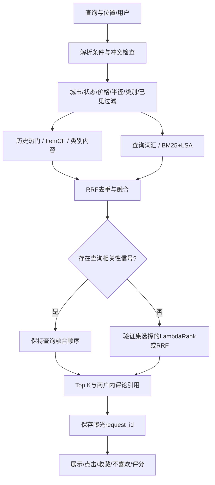

# 推荐系统完整闭环实施记录

2026年10月20日。API 0.4.0，承接query_v1。当前完成的是可本地运行、训练、评估、展示与记录反馈的推荐系统；多轮自主Agent、生产账号/部署和真实在线效果不在本次完成声明内。

## 完成度

| 模块 | 当前实现 | 验收依据 |
|---|---|---|
| 数据 | Tampa 3,805商户、332,829紧凑交互、29,092代表评论，manifest与独立派生产物 | 14/15文档、源哈希 |
| 画像 | 截止点历史画像、120,220个全历史演示画像、已见排除、冷启动 | 16/17文档、serving_v1 |
| 查询 | 有限中英文类别/排除/距离/价格协议、冲突澄清、文本/字段取严格交集 | 18/19文档、固定场景 |
| 召回 | 历史热门、ItemCF、类别TF-IDF、查询词汇、BM25＋LSA混合检索 | 单路与融合测试、search_v1 |
| 融合 | 去重、来源名次/分值、预算与白名单、RRF/加权RRF | fusion_v1、query_v1 |
| 学习排序 | LightGBM LambdaRank；验证集决定启用或保留RRF | ranking_v1、21文档 |
| 证据 | 返回商户内部评论检索、全文/句子/ID可追溯、相关提及与证据不足区分 | 负面提及及来源测试 |
| 服务 | FastAPI、可选画像、匿名与冷用户、依赖/模型故障降级、系统状态 | 完整API回归 |
| 反馈 | 曝光关联、impression/click/favorite/dislike/rating、幂等、归属、收藏/历史 | SQLite并发与错误注入测试 |
| 展示 | 本地/demo页面：查询、结果、引用、反馈、收藏、历史与状态 | 真实浏览器操作 |
| 实验 | 时间回放、共同目标、分群、固定查询对照、重复构建、聚合验收清单 | docs/experiments/completion_v1 |

## 最终请求链路



原有三个历史通道的预算仍为100；查询通道固定权重2，混合检索通道固定权重1。所有通道在Top100之前应用合法集合，排序只能重排已有候选。查询模型没有真实相关性训练标签，因此不把历史LambdaRank直接套到查询词/场景排序；纯硬约束排除、没有正向查询信号时可在已过滤集合上使用历史排序。

## 新模块与模型

- `retrieval/semantic.py`：BM25与TF-IDF/SVD LSA内部RRF；64维、38,265词，覆盖商户名称、类别和代表评论。JSON＋数值NPZ，不加载pickle。固定随机种子、源哈希、维度/词表/CSR校验及完整目录发布。LSA是统计潜在语义模型，不是预训练多语言Transformer。
- `ranking/learned.py`：13个可在线复用的历史特征，模型与特征schema校验、验证选择、异常转为可降级错误。
- `evaluation/ranking_study.py`：真实完整交互训练和两场景评估；不注入漏召回目标，不把未交互候选称为真实负反馈。
- `events.py`：SQLite曝光与事件事务、幂等event_id、演示用户及商户归属、收藏/历史/统计。
- `demo.py`、`static/demo.html`：本地演示，无外部CDN；源数据用textContent渲染，反馈绑定生成卡片时的曝光与用户。

排序13特征：RRF分、热门/CF/内容的倒数名次、CF/内容原分、历史热门分/正反馈用户数/贝叶斯评分、用户历史数/正反馈种子数、类别匹配和价格匹配。不使用未来商户stars/review_count、未来评分/正文、查询文本或伪造点击。静态类别与价格仍是当前资料快照，不具备完整历史版本。

线上成功启用学习排序时，score为ranking_score，并另返回rrf_score及channel_scores。查询请求返回ranking.reason=query_task_not_trained。模型缺失、损坏、schema/候选配置不一致或原生LightGBM错误时保留合法RRF结果；查询索引损坏时保留词汇/历史通道。状态接口可查看实际可用模块，更新模型后重启加载。

## 运行与重建

本次在backend/.venv中验证，原Conda目录不可写，未改变它的权限。新环境可建立独立Python3.11虚拟环境并安装requirements.txt；requirements.lock.txt记录本次确切依赖。以下均在v2/backend运行：

```powershell
.\.venv\Scripts\python.exe -B -m pytest -q
.\.venv\Scripts\python.exe -B -m pip check
.\.venv\Scripts\python.exe -B -m app.retrieval.semantic
.\.venv\Scripts\python.exe -B -m app.evaluation.ranking_study
.\.venv\Scripts\python.exe -B -m app.evaluation.query_study --include-search --output-dir data/derived/completion_query_regression
.\.venv\Scripts\python.exe -B -m uvicorn app.main:app --host 127.0.0.1 --port 8100
```

打开http://127.0.0.1:8100/demo，API文档/docs。search构建依赖processed商户与代表评论；ranking依赖14阶段完整交互。画像仍复用16阶段serving_v1，未混入新事件。新数据/索引/模型分别位于data/derived/search_v1、ranking_v1、demo_events；旧processed与实验目录不覆盖。模型/真实用户数据不入库。

## 接口与三分钟演示

| 接口 | 作用 |
|---|---|
| POST /api/v2/recommend | 推荐并返回metadata.request_id |
| GET /api/v2/system/status | 历史画像、检索、排序选择和事件状态 |
| POST /api/v2/events | event_id/request_id/user_id/business_id/event_type；rating仅评分事件必填1–5整数 |
| GET /api/v2/users/{user_id}/favorites | 本地演示用户收藏；后续dislike撤销收藏 |
| GET /api/v2/users/{user_id}/history | 本地反馈历史，limit上限1000 |
| GET /api/v2/events/metrics | 事件数量、展示数与去重描述比率 |

演示顺序：填一个演示用户ID，查询咖啡并查看引用；换披萨展示需求变化；收紧价格/距离展示条件交集；尝试金额预算观察澄清；点击/收藏/评分，查看收藏和历史；刷新状态说明检索与排序模式。已知Yelp画像ID可演示历史偏好，任意新ID走冷启动。

反馈只接受该曝光返回过的商户和同一演示user_id，重复event_id相同载荷返回原事件，不同载荷409；非曝光/跨用户404；非法类型/评分422。事件时间由服务端生成。展示卡片上报impression，单次推荐响应本身不当作已展示。event_store不可用不会破坏推荐，响应提示未保存，页面禁用反馈。

去重比率分母为有impression的(request_id,business_id)，分子为其中有click的项；重复点击和未展示点击不增加比率。原始click/impression事件比仍保留并明确可能大于1。它们都只是本地描述统计，不能用于宣称线上CTR。

## 完成边界

推荐系统核心及本地反馈展示闭环已完成。真实上线还需要身份认证、访问控制、部署监控、数据维护、真实查询标注和线上实验。演示身份与request_id不是生产认证；反馈保存但不会擅自触发重训练或污染固定测试。历史用户快照截止2022年，is_open不是现实此刻营业，金额不等于价格等级，类别不保证过敏/饮食认证。

自然语言理解仍有有限语法边界；LSA/BM25不是通用语义模型；评论相关提及不等于正面事实；没有多轮Agent或自由生成回答。上述边界与推荐系统的工程闭环分开记录，不能用本地验收替代生产效果结论。
